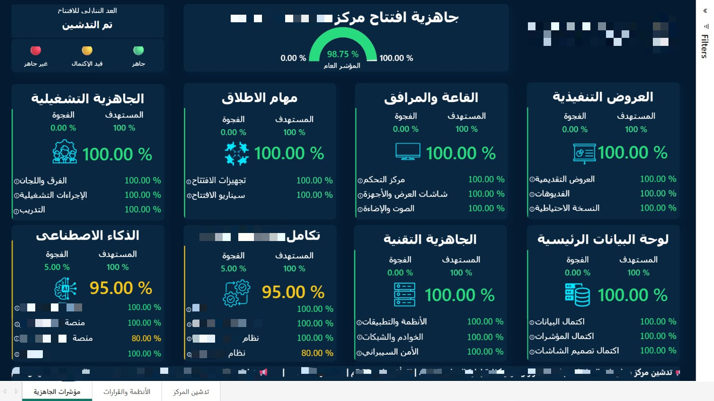
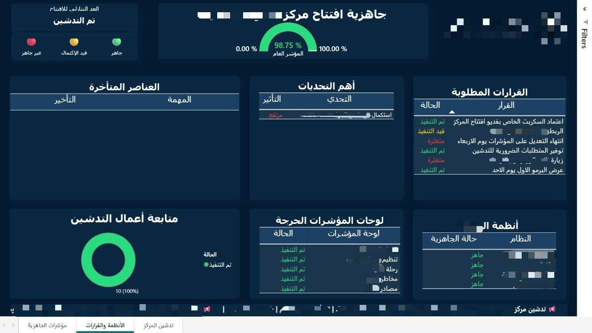

# Launch Readiness Dashboard

A Power BI dashboard designed to consolidate Excel-based readiness data into a clear visual overview of launch progress, pending decisions, and key challenges.

## Dashboard Preview

### Readiness Indicators

### Systems & Decisions

*Selected information has been redacted for confidentiality.*

## My Contribution

- Designed the dashboard layout, visual hierarchy, and consistent color scheme.
- Connected Excel data to Power BI to present readiness indicators, completion percentages, targets, and gaps.
- Organized report pages to display readiness metrics, system status, required decisions, and launch activities.
- Used color-coded status indicators to distinguish completed, ongoing, and blocked items.
- Integrated a custom countdown timer using **HTML, CSS, and JavaScript**, updating every second and displaying a launch-completion message when the target date was reached.
- Added a **scrolling announcement ticker** using **HTML and CSS** to display launch-related updates along the bottom of the report.

## Key Features

- An overall readiness gauge and detailed readiness indicators.
- Completion percentages, targets, and gap tracking across readiness areas.
- Tables for required decisions, challenges, delayed items, and system readiness.
- A chart summarizing launch activity completion.
- Arabic report labels and right-to-left announcement text.
- A countdown timer and scrolling announcement ticker.

## Tools & Technologies

| Technology | Purpose |
| --- | --- |
| Power BI | Dashboard design and data visualization |
| Microsoft Excel | Source data |
| HTML & CSS | Custom countdown and announcement ticker presentation |
| JavaScript | Countdown calculation and one-second updates |

## Project Scope

My role focused on dashboard development, data presentation, and custom visual elements. The displayed completion figures represent tracked project activities.
